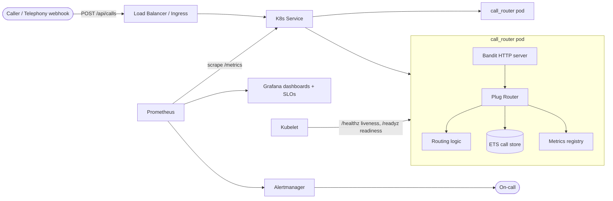
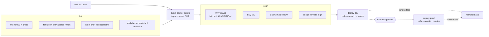
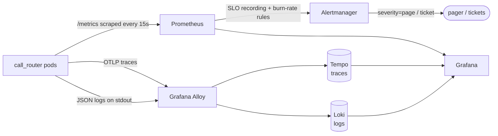
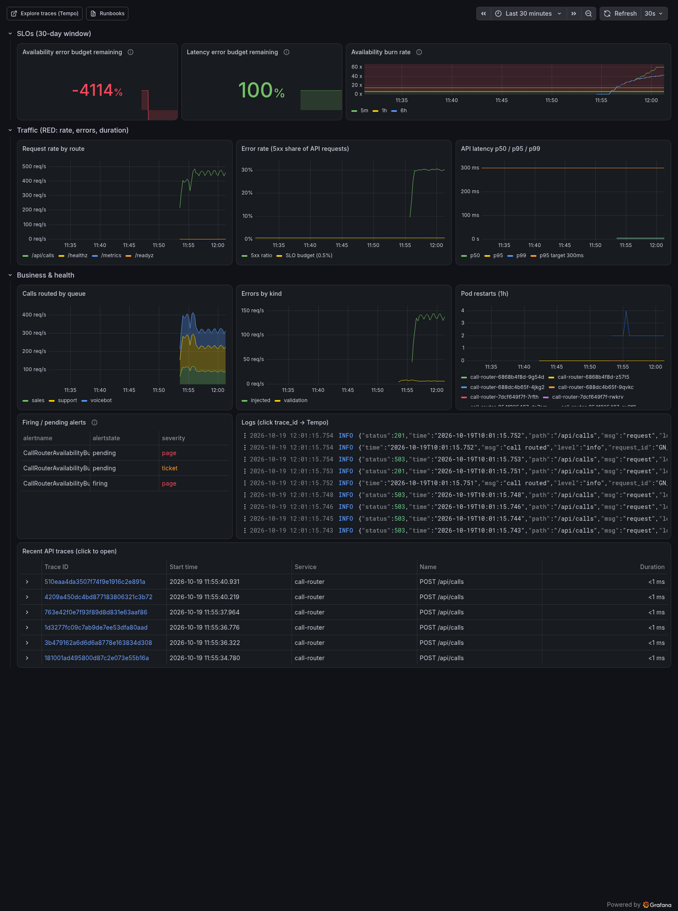
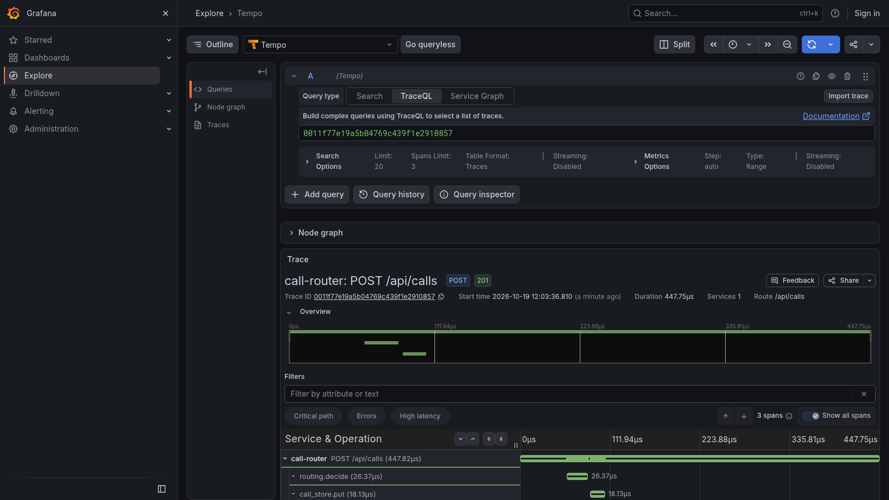
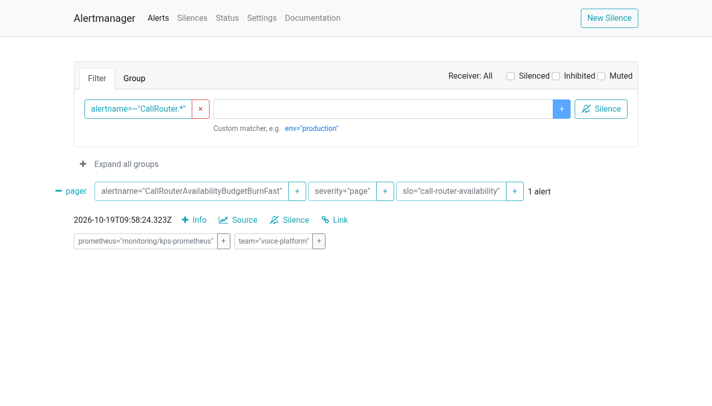
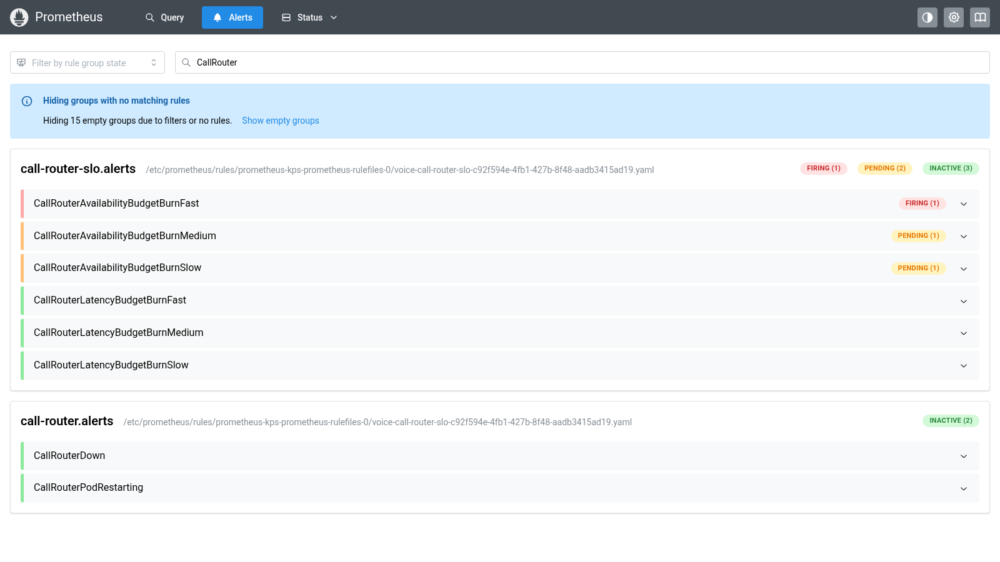

# voice-platform-ops

[](https://github.com/ErdagEge/voice-platform-ops/actions/workflows/ci.yml)

Production-style Elixir voice call-routing service on Kubernetes: Terraform, CI/CD, observability, SLOs, DR.

## Goal

This is a portfolio project showing how a small voice/AI platform service is
built **and operated**: containerised, deployed to Kubernetes (locally on
`kind`, in the cloud on GKE via Terraform), shipped through a GitLab-style
CI/CD pipeline, observed with Prometheus/Grafana, held to SLOs, protected with
backup/DR, and hardened with chaos tests and runbooks.

The service itself, `call_router`, is a tiny Elixir HTTP API that receives an
incoming call (`from`, `to`, `intent`) and decides which queue handles it:
`sales`, `support`, or the automated `voicebot`.

## Architecture



Planned infrastructure: Terraform provisions a GKE cluster + networking; Helm
deploys the app; CI builds, tests, scans and pushes the image, then deploys.

## Roadmap

- [x] Elixir app (`app/`): Plug + Bandit API, health/readiness probes, JSON logs, metrics, tests
- [x] Docker: multi-stage image, non-root, small runtime (`app/Dockerfile`, `docker-compose.yml`)
- [x] Kubernetes manifests / Helm chart (probes, resources, HPA, PDB) (`deploy/helm/call-router`)
- [x] kind local cluster (one-command local environment) (`kind/cluster.yaml`)
- [x] Terraform for GKE (VPC, cluster, node pools, Artifact Registry) (`infra/terraform`, validated offline, not applied)
- [x] CI/CD (GitLab-style pipeline: test, build, scan, deploy) (`.gitlab-ci.yml`, `.github/workflows/ci.yml`, `scripts/`)
- [x] Observability (Prometheus, Grafana, Alertmanager, Tempo traces, Loki logs) (`deploy/observability`, `app/lib/call_router/telemetry.ex`)
- [x] SLOs (availability + latency, error budgets, burn-rate alerts) (`slo/`, `docs/runbooks/`)
- [ ] Backup / DR (state backup, restore drills, RTO/RPO)
- [ ] Chaos tests & runbooks (pod kills, node drain, incident playbooks)

## Running the app locally

Requirements: Elixir 1.15+ and Erlang/OTP 26+.

```bash
cd app
mix deps.get
mix test                      # run the test suite
mix format --check-formatted  # lint formatting
PORT=4000 mix run --no-halt   # start the server (PORT defaults to 4000)
```

Try it:

```bash
curl localhost:4000/healthz
curl localhost:4000/readyz
curl -X POST localhost:4000/api/calls \
  -H 'content-type: application/json' \
  -d '{"from":"+32470000001","to":"+32800000000","intent":"billing"}'
# => {"call_id":"…","queue":"support","status":"routed",…}
curl localhost:4000/api/calls/<call_id>
curl localhost:4000/metrics
```

### Endpoints

| Method | Path             | Purpose |
|--------|------------------|---------|
| GET    | `/healthz`       | Liveness: process is up |
| GET    | `/readyz`        | Readiness: able to serve traffic |
| POST   | `/api/calls`     | Route a call; body `{from, to, intent}` → 201 with decision, 422 if invalid |
| GET    | `/api/calls/:id` | Fetch a stored call (404 if unknown) |
| GET    | `/metrics`       | Prometheus metrics: request counter + latency histogram, calls by queue, errors by kind, BEAM VM |

Intent mapping: `buy`/`pricing`/`sales` → `sales`; `help`/`support`/`billing`/`complaint` → `support`; anything else → `voicebot`.

### Configuration

| Env var     | Default | Description |
|-------------|---------|-------------|
| `PORT`      | `4000`  | HTTP listen port |
| `LOG_LEVEL` | `info` (prod) | Logger level (`debug`, `info`, `warning`, `error`) |
| `OTEL_EXPORTER_OTLP_ENDPOINT` | unset | OTLP/HTTP collector, e.g. `http://alloy.monitoring:4318`. Unset = tracing is a no-op |
| `OTEL_SERVICE_NAME` | `call-router` | `service.name` on every span |
| `FAULT_ERROR_RATE` | `0` | Demo only: share (0–1) of `POST /api/calls` answered with 503 |
| `FAULT_LATENCY_MS` | `0` | Demo only: extra delay added to `POST /api/calls` |

Logs are emitted as one JSON object per line (with `request_id`, `trace_id`,
`span_id`, `method`, `route`, `status`, `duration_ms`) so they can be indexed by Loki / Cloud Logging.

## Run with Docker

```bash
docker compose up --build -d   # build the image and start a container
make smoke                     # curl /healthz, /readyz, POST /api/calls, /metrics
docker compose down            # stop and remove it
```

Or without compose: `make docker-build && make docker-run` (`make help` lists all targets).

**Image vs container.** An *image* is a read-only package: OS libraries plus
our compiled app, built once from `app/Dockerfile`. A *container* is a running
instance of that image (like a process started from a program). The same image
runs on your laptop, in CI, in `kind`, and in GKE.

**Multi-stage build.** The first stage (`hexpm/elixir`) has compilers and the
Elixir toolchain and builds a `mix release`. The second stage is a slim
Debian image that only gets the finished release, so the final image is
about 157 MB, has no build tools and no source code, and has fewer things an
attacker could use.

**Why non-root.** The app runs as UID `10001`, not root. If someone exploits
the app, they can't change the image's files or easily escalate on the host,
and it works with Kubernetes `runAsNonRoot` policies. The compose file also
makes the filesystem read-only and drops all Linux capabilities.

## Run on Kubernetes (kind)

Requirements: Docker, [kind](https://kind.sigs.k8s.io/), `kubectl`, [Helm](https://helm.sh/) 3.

```bash
make kind-up      # create a 3-node cluster (1 control-plane + 2 workers)
make kind-load    # build the image and copy it into the kind nodes
make deploy       # helm upgrade --install with values-local.yaml
make kind-smoke   # curl the app via http://localhost:8080
kubectl -n voice get pods -o wide
make kind-down    # delete the cluster
```

`make helm-lint` runs `helm lint` and checks the rendered manifests against the
Kubernetes schemas with [kubeconform](https://github.com/yannh/kubeconform).

**The concepts, in brief:**

- **Pod**: the smallest unit Kubernetes runs: one (or a few) containers
  sharing a network address. Pods are disposable; they can be killed and
  replaced at any time.
- **Deployment**: says "keep 2 copies of this pod running". If a pod or node
  dies, it creates a replacement. When you ship a new version it does a
  *rolling update*: with `maxUnavailable: 0` a new pod must be Ready before
  an old one is stopped, so there is no downtime.
- **Service**: a stable name/IP in front of the changing set of pods, which
  load-balances only to pods that are Ready. Locally it's a `NodePort`
  (30080) that kind maps to `localhost:8080`; in GKE it will sit behind a
  load balancer.
- **Probes**: the kubelet calls `/healthz` (liveness: restart the container if
  it's stuck) and `/readyz` (readiness: stop sending traffic until it's ready).
- **Graceful shutdown**: on deletion, a `preStop` sleep lets the Service stop
  routing to the pod, then the app gets SIGTERM and has
  `terminationGracePeriodSeconds` to finish in-flight requests.
- **PodDisruptionBudget**: during node drains/upgrades, keep at least 1 pod up.
- **HPA** (optional, `autoscaling.enabled`): add pods when CPU is high.
- **ConfigMap / ServiceAccount**: config as env vars (`PORT`, `LOG_LEVEL`,
  `ERL_MAX_PORTS`) and a dedicated identity for the pods.
- **Helm**: a template engine + package manager for Kubernetes YAML. The
  chart in `deploy/helm/call-router` is the template; `values.yaml` holds
  defaults and `values-local.yaml` overrides them for kind. `helm upgrade
  --install` renders and applies everything as one versioned *release* that
  can be rolled back (`helm rollback`).

> Note: calls are stored in each pod's memory, so with 2 replicas
> `GET /api/calls/:id` may hit the other pod and return 404. Shared storage
> comes in a later step.

## Infrastructure (Terraform)

**What Terraform is.** You describe the cloud resources you want (network,
cluster, registry) in `.tf` files. `terraform plan` compares that with what
exists and shows the changes; `terraform apply` makes them. The same code
always gives the same infrastructure, changes go through code review, and
the infrastructure is documented by the code itself.

```
infra/terraform/
├── .tflint.hcl
├── modules/                 # reusable building blocks
│   ├── network/             # VPC, subnet (+ pods/services ranges), Cloud Router + NAT, deny-all firewall
│   ├── gke/                 # private GKE Standard cluster + autoscaling node pool + node service account
│   └── artifact-registry/   # Docker repo with cleanup policies + pull-only IAM
└── envs/                    # "root modules": one per environment
    ├── dev/                 # versions.tf, main.tf, variables.tf, outputs.tf,
    └── prod/                # backend.hcl.example, terraform.tfvars.example
```

**Modules** are like functions: inputs (`variables.tf`, with descriptions and
validation), resources (`main.tf`), return values (`outputs.tf`). `envs/dev`
and `envs/prod` call the same modules with different settings, so the two
environments differ only on purpose.

**What gets built (GKE design):**
- VPC-native networking: pods and Services get real VPC IPs from secondary ranges.
- **Private nodes**: no public IPs, outbound only through Cloud NAT. The
  Kubernetes API is reachable only from `master_authorized_networks`.
- **Workload Identity**: pods use Google APIs without key files.
- **Dataplane V2**: enforces Kubernetes NetworkPolicies.
- **Shielded nodes** + secure boot, COS image, legacy metadata endpoints disabled.
- A **least-privilege node service account** (logs/metrics writer, pull from
  our registry only) instead of the default Editor-level account.
- A **release channel** with auto-upgrade/auto-repair, surge upgrades
  (`max_unavailable = 0`), a weekend maintenance window.
- **Cloud Logging/Monitoring** + Managed Service for Prometheus enabled.
- A separate **autoscaling node pool** with an optional **Spot** mode.

| | dev | prod |
|---|---|---|
| Cluster | zonal (`europe-west1-b`) | regional (`europe-west1`, 3 zones) |
| Nodes | `e2-standard-2`, 1-3, **Spot** | `e2-standard-4`, 1-4 per zone (3-12), on-demand |
| Release channel | REGULAR | STABLE |
| Deletion protection | off | on |
| Image tags | mutable | immutable |

**State and backends.** Terraform records what it created in a *state* file.
Locally that's a file on disk, which is fragile and can't be shared with
teammates or CI. Here state is stored in a **GCS bucket** (`backend "gcs"`), which
is versioned (recover old state) and locked (no two applies at once). The
backend is a *partial* config: the bucket name comes from `backend.hcl`.

**Offline checks** (no cloud account needed):

```bash
make tf-check   # = tf-fmt + tf-validate (init -backend=false) + tf-lint (tflint) + tf-scan (trivy/checkov)
```

Accepted scanner findings are skipped in code with the reason written next
to them (e.g. no customer-managed encryption keys yet; Binary Authorization
planned with CI image signing).

**How it would be applied for real** (not done in this repo, and it costs money):

```bash
gcloud auth login && gcloud auth application-default login
gcloud config set project <project-id>
# one-time: state bucket (see envs/dev/backend.hcl.example)
gcloud storage buckets create gs://<project-id>-tfstate --location=europe-west1 \
  --uniform-bucket-level-access --public-access-prevention
gcloud storage buckets update gs://<project-id>-tfstate --versioning

cd infra/terraform/envs/dev
cp backend.hcl.example backend.hcl            # set bucket
cp terraform.tfvars.example terraform.tfvars  # set project_id, your IP
terraform init -backend-config=backend.hcl
terraform plan -out=tfplan                    # review!
terraform apply tfplan
$(terraform output -raw get_credentials_command)
```

In CI the same steps run with Workload Identity Federation instead of a
personal login, with `plan` on merge requests and a manual `apply` approval.

**Cost notes** (rough, list prices, europe-west1, check the
[pricing calculator](https://cloud.google.com/products/calculator)):
- GKE cluster management fee ≈ $0.10/hour (~$73/month) per cluster; the free
  tier credit covers one zonal or Autopilot cluster per billing account.
- dev: 1 Spot `e2-standard-2` ≈ $15-25/month + NAT (~$1/day + traffic) + disks.
- prod: at least 3 on-demand `e2-standard-4` ≈ $300+/month, plus regional fee,
  NAT, logging volume and load balancers.
- Flow logs, intranode visibility and log ingestion are billed by volume;
  sampling is lower in dev.
- Run `terraform destroy` on dev when it isn't in use (prod has deletion protection).

## CI/CD

Two pipelines with the same stages, both calling the same scripts in
`scripts/`, so they behave the same:

- **`.gitlab-ci.yml`**: the main one (the target platform uses GitLab):
  builds to the GitLab registry, deploys to GKE `dev` automatically and to
  `production` after a manual approval.
- **`.github/workflows/ci.yml`**: runs on every push/PR to this GitHub repo.
  Instead of GKE it deploys to a **throwaway kind cluster on the runner**, runs
  the smoke test, and proves that a broken release is rolled back.



| Script | What it does |
|---|---|
| `scripts/deploy.sh` | `helm upgrade --install --atomic --wait --timeout`, then the smoke test; `helm rollback` if the smoke test fails |
| `scripts/ci-smoke.sh` | checks `/healthz`, `/readyz`, `POST /api/calls`, 422 on bad input, `/metrics` |
| `scripts/rollback-demo.sh` | deploys a release with a broken readiness probe and checks that `--atomic` rolls it back |
| `scripts/gcp-auth.sh` | GitLab OIDC token → Google credentials via Workload Identity Federation |

Run them against kind locally: `make ci-deploy-kind` and `make rollback-demo`.

**Concepts, briefly:**
- **Stages and jobs.** Each job runs in a clean container. Stages run in order
  (lint → test → build → scan → deploy), and a failure stops the pipeline
  before anything bad reaches a cluster. `needs:` lets independent jobs start early.
- **Artifacts and caches.** *Artifacts* are files passed between jobs (the
  image tarball, the SBOM, the image digest). *Caches* (Mix deps, Docker layers,
  the Trivy DB) only make jobs faster; nothing depends on them.
- **Immutable images.** Every image is tagged with the commit SHA and deployed
  by digest, so you always know which commit is running. Rolling back means
  deploying an older SHA.
- **Supply chain.** Trivy fails the build on fixable HIGH/CRITICAL CVEs, an
  SBOM lists every package in the image, and cosign signs the image digest
  using the CI system's identity, with no signing key to store. Later, GKE
  Binary Authorization can refuse unsigned images.
- **Atomic deploys and rollback.** `--atomic --wait` means "wait until all new
  pods are Ready; if that doesn't happen in time, automatically roll back".
  Because the chart uses `maxUnavailable: 0`, the old pods keep serving the
  whole time. A release that is "Ready" but wrong is caught by the smoke test,
  which runs `helm rollback`.
- **Environments and approval.** GitLab *environments* (`dev`, `production`)
  record what is deployed where and allow one-click re-deploys. Prod is
  `when: manual` and should be a *protected environment* with required
  approvers. `resource_group` prevents two deploys to the same environment at once.
- **OIDC instead of keys.** A JSON service-account key in CI variables is
  a long-lived password: if it leaks, it works until someone notices. With
  Workload Identity Federation, GitLab issues a short-lived signed token
  per job (`id_tokens:`). Google checks it (project, branch) and returns a
  credential that expires in about an hour. The CI settings hold only resource
  names, no secrets. On GitHub, `GITHUB_TOKEN` (push to GHCR) and the OIDC
  token for cosign work the same way.

## Observability & SLOs

Everything here runs locally on kind with free, open-source components. No
paid service or cloud account is involved.



```bash
make kind-up kind-load   # cluster + image (see above)
make obs-up              # kube-prometheus-stack, Tempo, Loki, Alloy + SLO rules (~5 min the first time)
make deploy              # app; the ServiceMonitor is only created once its CRD exists,
                         # so run (or re-run) this after obs-up
make load DURATION=300   # generate traffic
make grafana             # http://localhost:3000 (admin/admin, anonymous view enabled)
make prometheus          # http://localhost:9090
make alertmanager        # http://localhost:9093
make slo-check slo-test  # promtool: validate rules + run SLO unit tests
make obs-down            # remove the stack
```

| Path | What it is |
|---|---|
| `app/lib/call_router/telemetry.ex` | `:telemetry` events → Prometheus metrics (counters, latency histogram, VM stats) |
| `app/lib/call_router/tracing.ex` | OpenTelemetry spans; copies `trace_id` into every log line |
| `deploy/observability/*.values.yaml` | One Helm values file per component (kube-prometheus-stack, Tempo, Loki, Alloy) |
| `deploy/helm/call-router/templates/servicemonitor.yaml` | Tells Prometheus to scrape the app (`serviceMonitor.enabled`) |
| `deploy/helm/call-router/dashboards/call-router.json` | Grafana dashboard, loaded by the Grafana sidecar (`grafanaDashboard.enabled`) |
| `slo/call-router-slo.rules.yml` | SLIs, error budget and multi-window burn-rate alerts (plain Prometheus rules) |
| `slo/tests/*.test.yml` | `promtool test rules` unit tests: fake traffic in, expected alerts out |
| `docs/runbooks/` | One runbook per alert; every alert links to its page via `runbook_url` |

### The SLOs

| SLO | SLI (what we measure) | Target | Error budget (30 days) |
|---|---|---|---|
| Availability | share of `/api/*` requests that do **not** return 5xx | 99.5 % | 0.5 % of requests (≈ 3.6 h of full outage) |
| Latency | share of `/api/*` requests served in **< 500 ms** | 99 % | 1 % of requests may be slower |

| Alert | Burn rate | Windows (long AND short) | `for` | Severity | Budget used when it fires |
|---|---|---|---|---|---|
| `…BudgetBurnFast` | 14.4× | 1h and 5m | 2m | page | 2 % in 1 hour |
| `…BudgetBurnMedium` | 6× | 6h and 30m | 15m | page | 5 % in 6 hours |
| `…BudgetBurnSlow` | 1× | 3d and 6h | 1h | ticket | 10 % in 3 days |

Plus two symptom alerts, `CallRouterDown` (no healthy target for 2m) and
`CallRouterPodRestarting` (more than 3 restarts in 15m). Alertmanager routes
`severity=page` to a `pager` receiver and `severity=ticket` to `tickets`. These
are empty placeholders here; in production they would be PagerDuty/Opsgenie and
a ticket queue. A firing page suppresses the ticket alert for the same SLO.

### Verified on kind

With `--set config.faultErrorRate=0.3`, 30 % of `POST /api/calls` return 503.
The 5-minute error ratio rose to about 15 % of all API traffic, about 30× the
budget rate. `CallRouterAvailabilityBudgetBurnFast` went *pending* and then
*firing* after 2 minutes, reached Alertmanager as `severity=page` on the
`pager` receiver, and linked to its runbook. The slower alerts were *pending*
as expected.



The dashboard has SLO budget remaining and burn rate, RED metrics (rate,
errors, p50/p95/p99 latency), calls by queue, errors by kind, pod restarts,
firing alerts, live logs and recent traces. The budget shows a large negative
number because the 30-day window holds only a few minutes of data, all at a
30 % error rate.



This is one `POST /api/calls` request as a trace: the HTTP server span plus
the child spans `routing.decide` and `call_store.put`. Clicking the `trace_id`
in a Loki log line opens this view.





**Resources.** The whole kind cluster, including Kubernetes itself, the app, the
monitoring stack and the load generator, used about 4.4 GB RAM. Prometheus
(400 Mi request, 2-day retention) is the largest piece. Persistence is off for
Tempo and Grafana, so a restart clears traces. That is fine for a demo. CI only
runs `promtool` and installs the ServiceMonitor CRD; it does not install the
full stack.

**Concepts, briefly:**
- **Metrics, logs and traces.** *Metrics* are numbers over time (requests/s,
  p99 latency). They are cheap to keep and good for dashboards and alerts:
  "*something* is wrong". *Logs* are one line per event with details: "*what*
  happened to this request". *Traces* follow one request through every step
  with timings: "*where* the time went". Here they are linked. A log line
  carries the `trace_id`, so you can jump from an error log to its trace.
- **Histograms and percentiles.** The app counts each request into latency
  buckets (≤5 ms, ≤10 ms, … ≤500 ms, …). Prometheus can then compute p50, p95
  and p99 for any time range and across pods, which a pre-computed average
  cannot do.
- **SLI, SLO, error budget.** An *SLI* is a measurement of what users feel
  (the share of successful, fast requests). The *SLO* is the target for it
  (99.5 % over 30 days). The *error budget* is the rest (0.5 %). That amount
  of failure is allowed. While budget is left you can ship risky changes; when
  it is used up, reliability work comes first.
- **Burn rate.** The burn rate is how fast you spend the budget. 1× uses it up
  in exactly 30 days, and 14.4× uses it up in about 2 days. Alerting on burn
  rate means paging for "we will miss the SLO soon" and not for every blip.
- **Multi-window alerts.** Each alert needs a long window (e.g. 1h, so it is
  significant) *and* a short one (e.g. 5m, so it is still happening) to be
  over the threshold. This filters out short spikes and lets the alert clear
  quickly once the problem is fixed. Fast burns page a human; slow burns open
  a ticket.
- **Rules as code.** The SLO rules are a plain file checked by
  `promtool check rules` and unit-tested with `promtool test rules` in both
  pipelines, the same way the Elixir code is tested.

## License

MIT - see [LICENSE](LICENSE).
