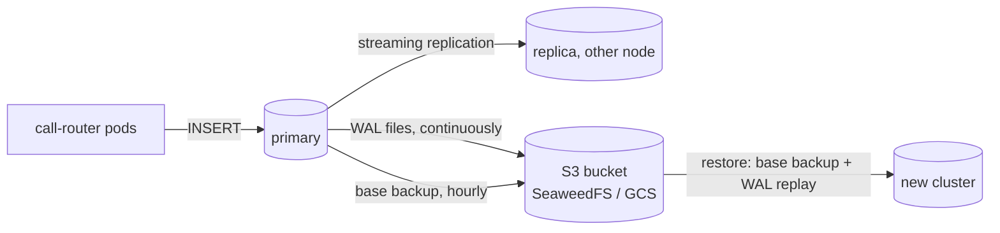

# Backup & disaster recovery

## What is protected, and how

| Data / state | Where it lives | Protection | Restore with |
|---|---|---|---|
| Calls (PostgreSQL `app` DB) | CloudNativePG cluster `call-router-db`: primary + streaming replica on different nodes | **Continuous WAL archiving** (every change, segments closed at least every 60 s) + **hourly base backups** to S3 (Barman Cloud plugin), 7-day retention | `scripts/restore.sh` (newest state) or `TARGET_TIME=... scripts/restore.sh` (point in time) |
| Kubernetes objects (Deployment, Service, ConfigMaps, PrometheusRules, dashboards) | Git: Helm charts + `slo/` | Git *is* the backup; CI can redeploy any commit | `scripts/restore.sh` redeploys them, or `make deploy` / `make slo-apply` |
| Secrets: DB app user | Created by CNPG with each cluster | Recreated on restore; the app reads it from the Secret, nothing to copy | automatic |
| Secrets: S3 backup credentials | `backup` namespace (kind) / Secret Manager (GKE) | Outside the namespace being protected | `scripts/backup-store-up.sh` copies them back |
| Container images | GHCR / Artifact Registry, tagged by commit SHA | Registry retention | redeploy the SHA |
| Metrics, logs, traces | Prometheus / Loki / Tempo (2-day retention, no persistence on kind) | **Not backed up**: telemetry, rebuildable | n/a |

The backup store on kind is **SeaweedFS** (S3 API, namespace `backup`). It replaces
MinIO, whose community edition no longer ships container images. On GKE the same
role is played by a **GCS bucket** in another project, with Object Versioning and a
retention lock (see *GKE / Cloud SQL* below).

## Targets

| | Target | Measured on kind (2026-10-20) | Why this target |
|---|---|---|---|
| **RPO** (max data loss) | **≤ 60 s** | **1 s** (graceful), **17 s** (crash: PostgreSQL SIGKILLed with no clean shutdown) | `archive_timeout: 60s` closes a WAL segment at least every minute, so at most ~1 min of commits is only on the lost disk |
| **RTO**: DB lost, cluster healthy | **≤ 15 min** | **99 s** (crash drill: 32 s namespace deletion + 57 s new 2-instance cluster restored from base backup + WAL + 9 s app deploy & smoke test) | Team target incl. human decision time; the automation itself is ~1-2 min |
| **RTO**: primary instance/node lost | **≤ 1 min**, no data loss | failover in **see [chaos 04](../chaos/results/04-db-failover.md)** | Replica promotion by CNPG, no restore needed |
| **RTO**: whole Kubernetes cluster lost | ≤ 1 h | not drilled on kind (would be `make kind-up obs-up db-operators-up backup-store-up` + restore against an external bucket) | Terraform recreates GKE in ~15 min; then the same restore |
| Backup verification | restore drill **monthly** + after every backup-config change | `scripts/dr-drill.sh` | A backup counts only after it has been restored |

Drill reports: [docs/dr-drills/](dr-drills/).

## How the backups work (beginner version)

PostgreSQL writes every change to its **write-ahead log (WAL)** before it writes the
table files. The WAL is a diary of every change, in 16 MB files. CloudNativePG's
Barman Cloud plugin runs as a sidecar next to the database. It **uploads each WAL file
as soon as it is complete** and takes a **base backup** (a full copy of the data
files) every hour. To restore, a brand-new PostgreSQL starts from the newest base
backup and **replays the WAL** on top of it. Because the WAL contains every change,
it can stop at any second you choose: that's **point-in-time recovery (PITR)**,
e.g. "just before someone ran `DELETE FROM calls`".



Two copies, two failure types:
- **Replica**: protects against a dead *node or disk* in seconds (failover), but would
  faithfully replicate a `DROP TABLE` too.
- **Backups**: protect against *everything else* (deleted namespace, corruption,
  human error, lost cluster), at the cost of an RTO of minutes and an RPO of seconds.

## Runbook: restore

```bash
# 0. Decide (IC): restore = new cluster from backup. Up to RPO (~1 min) of writes may be lost.
# 1. If the old cluster still exists but is broken, delete it (backups in S3 are not touched):
make db-down
# 2. Restore the newest state, redeploy the app and alert rules, run the smoke test:
scripts/restore.sh
#    ... or to a point in time (UTC):
TARGET_TIME="2026-10-20 18:30:00+00" scripts/restore.sh
#    ... or from a specific backup folder:
SOURCE=call-router-db-20261020T183939 scripts/restore.sh
# 3. Verify: smoke test passed (printed), then check the latest calls:
make db-psql   # SELECT count(*), max(created_at) FROM calls;
# 4. Take a fresh base backup of the new cluster:
scripts/backup.sh
```

Every new cluster archives into its **own folder** (`call-router-db-<timestamp>`,
chosen by `scripts/db-up.sh`). A restored database starts a new *timeline*, and
mixing two timelines in one folder would corrupt the backup history. `restore.sh`
finds the newest folder by itself.

## DR drill

`scripts/dr-drill.sh` proves all of the above end to end, on kind:

1. writes 20 known calls (set A) and takes a backup,
2. writes 1 call per second for 75 s (set B, protected only by WAL archiving),
3. **deletes the `voice` namespace** (`DISASTER=crash` also SIGKILLs PostgreSQL),
4. restores (`scripts/restore.sh`) and runs the smoke test,
5. checks that **every** set-A call is back and counts the set-B survivors (→ RPO),
   and measures disaster → smoke test passed (→ RTO).

| Drill | Set A | Set B | RPO | RTO | Report |
|---|---|---|---|---|---|
| graceful delete | 20/20 | 74/74 | 1 s | 176 s* | [report](dr-drills/2026-10-20-2036-dr-drill-graceful.md) |
| crash (SIGKILL) | 20/20 | 58/74 | 17 s | 99 s | [report](dr-drills/2026-10-20-2041-dr-drill-crash.md) |

\* 108 s of it was Kubernetes waiting for PostgreSQL's clean shutdown during the
namespace deletion. That's what got the last WAL archived, hence RPO 1 s.

Lessons from the drills:
- The **crash** case is the honest RPO: 16 calls written in the last 17 s were lost,
  because their WAL segment was not yet closed and uploaded. That's within the 60 s
  target. Shrinking it further would mean synchronous replication to a replica in
  another zone (CNPG `minSyncReplicas: 1`), which trades a little write latency for
  RPO ≈ 0 on node loss (but not on namespace/cluster loss).
- The restored cluster is a **new** cluster: new instance names, a new app-user
  password Secret, new backup folder. The app needs nothing, because it reads
  everything from the Secret.

## Not covered here (yet)

- **Velero** (backups of Kubernetes objects and volume snapshots) is not installed: everything
  in the `voice` namespace is either rebuilt from Git or from the database backups, which
  the drill shows. Velero would become useful once the cluster holds state that isn't
  in Git (manually created Secrets, operators' CRs created by hand).
- Backups are not encrypted at rest on kind (SeaweedFS); on GKE use a CMEK-encrypted bucket.

## GKE / Cloud SQL equivalent

On GKE the same design can stay in-cluster (CloudNativePG on regional PDs, backups to
GCS through Workload Identity), or use the managed service:

| This repo (kind) | Cloud SQL for PostgreSQL |
|---|---|
| CNPG primary + replica, anti-affinity | `availability_type = "REGIONAL"`: synchronous standby in a 2nd zone, automatic failover |
| WAL archiving + hourly base backups to S3 | Automated daily backups + `point_in_time_recovery_enabled = true` (transaction logs, 7 days) |
| `scripts/restore.sh` → new cluster | Restore/clone to a new instance, or PITR clone to a timestamp (`gcloud sql instances clone --point-in-time`) |
| SeaweedFS in another namespace | Backups in Google-managed storage; add cross-region backup location for region loss |
| `call-router-db-app` Secret from CNPG | Secret Manager + External Secrets Operator → `call-router-database` Secret (`values-gke-*.yaml`) |
| Private Service in the cluster | Private IP via Private Service Access on the Terraform VPC; IAM DB auth or Cloud SQL Auth Proxy sidecar |

A Terraform sketch (not part of the validated modules):

```hcl
resource "google_sql_database_instance" "calls" {
  name             = "call-router-${var.env}"
  database_version = "POSTGRES_17"
  region           = var.region
  settings {
    tier              = "db-custom-1-3840"
    availability_type = "REGIONAL"          # HA standby in another zone
    backup_configuration {
      enabled                        = true
      point_in_time_recovery_enabled = true # WAL-based PITR
      transaction_log_retention_days = 7
      backup_retention_settings { retained_backups = 14 }
    }
    ip_configuration {
      ipv4_enabled    = false               # private IP only
      private_network = module.network.network_id
    }
  }
  deletion_protection = true
}
```
