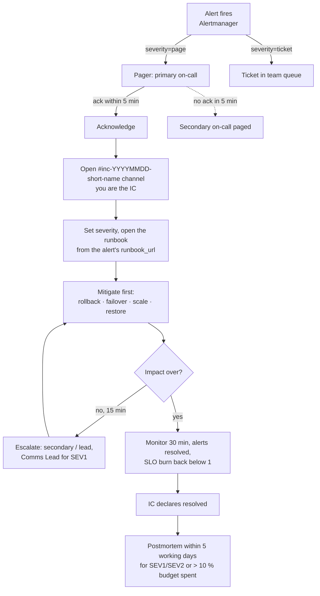

# Incident response

How the voice-platform team handles production incidents for call-router.
It's written for a small team (2-6 engineers) running a week-long on-call
rotation. The process is small on purpose: under stress, people follow short
checklists, not long documents.

## Severity levels

| Severity | Definition (any one is enough) | Examples | Response |
|---|---|---|---|
| **SEV1** | Calls fail for most customers; data loss; security breach | API down, DB down, restore from backup needed | Page now, IC + Comms Lead, status-page update within 15 min, updates every 30 min |
| **SEV2** | Partial or degraded service; SLO budget burning fast | 5-20 % of calls fail, p99 > 1 s, one region/queue broken | Page, IC; customer update if > 30 min |
| **SEV3** | No current customer impact, but risk | HA lost (no DB replica), backups failing, slow budget burn | Ticket, fix in working hours |
| **SEV4** | Cosmetic / internal | Dashboard broken, noisy alert | Backlog |

Alerts map to severities by their `severity` label: `page` alerts usually start a
SEV1/SEV2, and `ticket` alerts are SEV3. The Incident Commander can raise or
lower the severity at any time. When unsure, **pick the higher one**.

## Roles

For SEV1/SEV2 the first responder is the **Incident Commander (IC)** until they
hand the role over. In a small team one person may hold two roles, but the IC
should not be the person typing the fix.

| Role | Responsibilities |
|---|---|
| **Incident Commander** | Owns the incident: sets severity, assigns roles, decides (rollback? restore? failover?), keeps the timeline, declares the end. |
| **Operations Lead** | Hands on keyboard: follows the runbook, runs the commands, reports what they see. |
| **Communications Lead** | Status page, customer success / telephony partners, internal stakeholders. Updates on a fixed schedule even when nothing changed. |
| **Scribe** (optional) | Writes the timeline (time, who, what) in the incident channel, which is the raw material for the postmortem. |

## On-call flow

1. **Acknowledge** the page within 5 minutes; otherwise it escalates to the secondary.
2. **Open a channel** `#inc-<date>-<short-name>` and post: *"I'm IC, investigating <alert>, SEV?"*.
3. **Follow the runbook** linked from the alert (`runbook_url`, [docs/runbooks/](runbooks/)).
4. **Mitigate before you diagnose.** A rollback (`helm -n voice rollback call-router`),
   a failover or scaling out that ends the impact beats a root cause found 40 minutes later.
5. **Communicate:** for SEV1, update the status page within 15 minutes, then every 30 minutes.
6. **Escalate early:** not mitigated after 15 minutes? Bring in more people. Nobody gets blamed for a page.
7. **Resolve:** alerts are clear, the SLI has been back within its SLO for 30 minutes, and the IC declares the end.
8. **Follow up:** write a [postmortem](postmortems/TEMPLATE.md) for every SEV1/SEV2 and for anything
   that used more than 10 % of a monthly error budget.

## Communication templates

**Status page / customer update (SEV1):**
> *Investigating*: Some incoming calls are currently not being routed. We are
> working on it and will update this page by HH:MM CET.
>
> *Mitigated*: Call routing has been restored as of HH:MM CET. Calls placed
> between HH:MM and HH:MM may have failed. We are monitoring.
>
> *Resolved*: The issue is resolved. A post-incident report will follow.

**Internal update (every 30 min):** what's broken, what we did, what's next, the next update time.

## Error budget policy

The SLOs ([README](../README.md#observability--slos)) come with a simple policy:

- **Budget > 25 % left:** ship normally; chaos experiments are allowed.
- **Budget < 25 %:** only low-risk changes, and every deploy has a rollback plan.
- **Budget exhausted:** freeze feature deploys until the 30-day window recovers. Only
  reliability fixes ship, and the next sprint prioritises postmortem action items.

## Tools

| What | Where |
|---|---|
| Alerts | Alertmanager (`make alertmanager`), receivers `pager` / `tickets` |
| Dashboards | Grafana `call-router` (`make grafana`): SLO, RED metrics, logs, traces |
| Runbooks | [docs/runbooks/](runbooks/) |
| Disaster recovery | [docs/dr.md](dr.md), `scripts/restore.sh` |
| Postmortems | [docs/postmortems/](postmortems/) |
